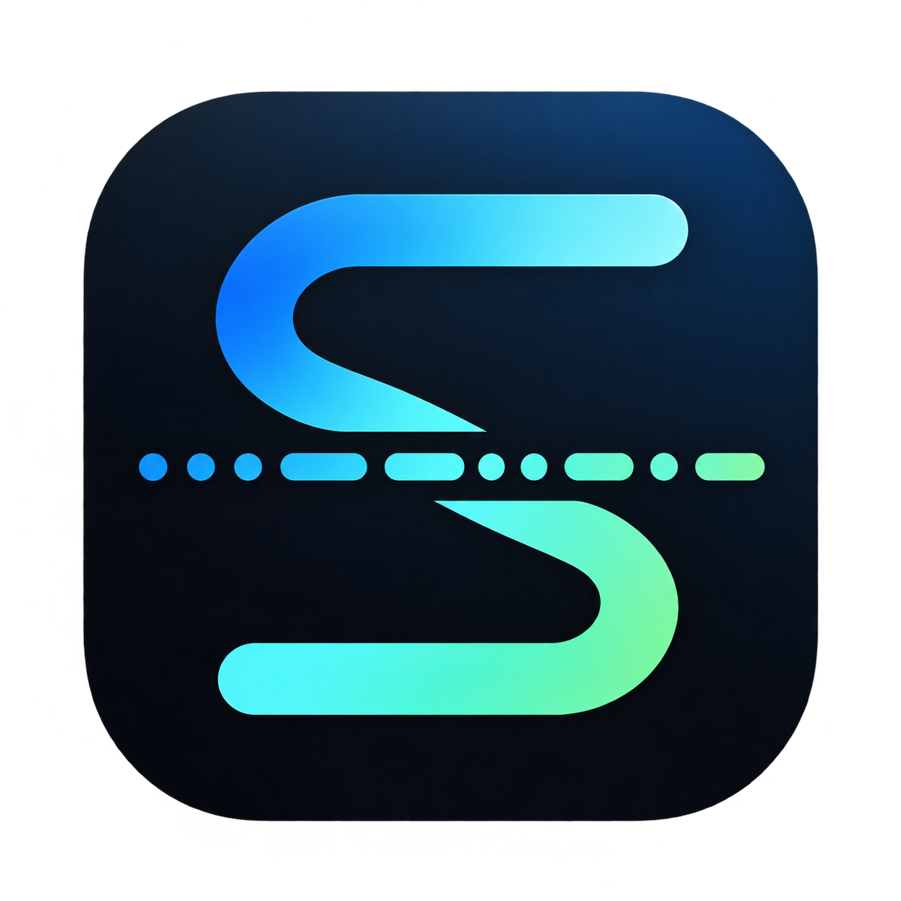
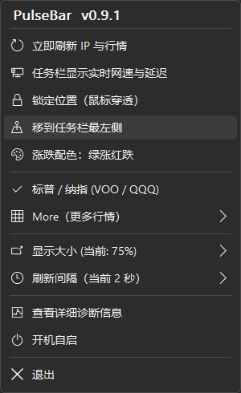
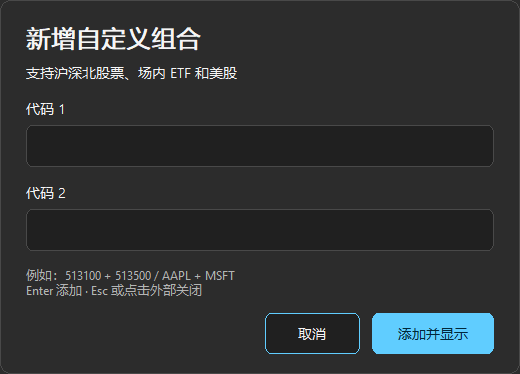
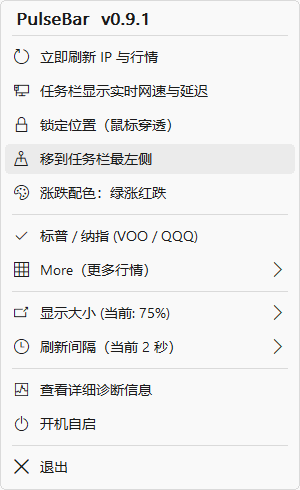
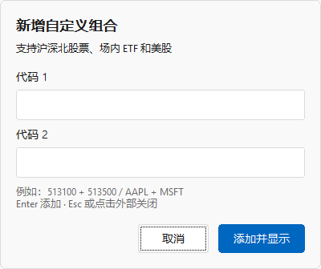

# PulseBar




[](https://github.com/hrthas-king/PulseBar/actions/workflows/ci.yml)

**合二为一的极轻量 Windows 任务栏网络脉搏（GeoPulse）与 VOO / QQQ 24小时全时段实时行情条（TickBar）。**

当前版本：**v0.9.1（2026-10-28）**。下载程序请前往 [GitHub Releases](https://github.com/hrthas-king/PulseBar/releases/tag/v0.9.1)，检查结果与待验证事项见 [验证记录](docs/VALIDATION.md)。

双击单个 `~3.5 MiB`（amd64 本地构建）的 `.exe` 即可静默运行，同时在 **任务栏最左侧悬浮条** 与 **系统托盘** 展示：
1. **GeoPulse 秒级网络感知**：公网出口两位国家代码、连通性状态灯（绿/黄/红）、上下行实时流量活动箭头（或一键展开实时网速与 HTTPS 请求延迟）、TUN/系统代理节点切换自动感知。
2. **TickBar VOO / QQQ 24×5 全时段无缝实时行情**：追踪 `VOO`（标普 500 ETF）与 `QQQ`（纳斯达克 100 ETF），无缝覆盖美东时间周日 20:00 至周五 20:00 的 **夜盘（Overnight）+ 盘前（Pre-Market）+ 盘中（Regular）+ 盘后（Post-Market）** 24 小时连续实时价格流与日涨跌幅。

纯 Go 标准库直接调用 Win32 GDI、Shell_NotifyIcon、IP Helper 与 WinHTTP 系统 API；无 CGo、无 Python 解释器打包、无 Electron/WebView，运行期第三方依赖为零。v0.9.1 的一次 10 秒 GUI 实测私有工作集约 **5.91 MiB**；完整资源记录及行情延迟的待验证范围详见 [验证记录](docs/VALIDATION.md)。

---

## 核心特性

### 1. 任务栏悬浮条 + 系统托盘双视图

- **Fluent 菜单与输入面板**：参考 TranslucentTB 的菜单视觉，采用圆角高亮、图标、分组分隔和统一留白，跟随 Windows 应用深浅色。支持悬停级联、方向键 / Enter / Esc、长列表滚动及组合行旁删除；输入面板统一为圆角输入框、强调色按钮和行内错误提示。透明行情条保持原有外观。
- 菜单与输入面板按系统 DPI 显示，不随行情条的 75%～130% 大小设置缩小。高对比度或系统报告屏幕阅读器开启时，菜单使用原生菜单回退。
- 鼠标横向或斜向移入左、右子菜单时保留父菜单，进入子菜单后取消待切换状态。菜单不显示滚动条；长列表仍可通过滚轮、方向键与 Home / End 浏览。

<details>
<summary>菜单与输入面板预览（深色 / 浅色）</summary>

 

 

</details>

- **紧凑模式（默认）**：`[● US ↑↓ | ● VOO 699.48 +0.13% | ● QQQ 704.35 -0.01%]`
  - 左侧显示出口国家代码、连通状态圆点与随流量亮起的上下行箭头；右侧同屏显示 `VOO` 与 `QQQ` 的 24h 实时成交价与当前时段涨跌幅（每 `$0.01` 跳动即刻可见）。
- **详细网速模式（右键菜单一键切换）**：`[● US ↑12K ↓1.5M 18ms | ● VOO 699.48 +0.13% | ● QQQ 704.35 -0.01%]`
  - 在任务栏悬浮条上直接展开实时上行速率、下行速率与 HTTPS 请求延迟。
  - 延迟每 **5 秒**独立测量一次，目标为 `https://www.cloudflare.com/cdn-cgi/trace`，跟随系统代理/TUN；数值包含 DNS、建连、TLS 与响应头耗时。失败、超过 **15 秒**未更新或正在切换出口时显示 `--`，详细提示中标明测量目标。连通状态由心跳与通信证据单独判断。
- **系统托盘动态图标**：32×32 像素级实时绘制两位国家代码、状态点与上下行闪烁箭头。当悬浮条开启**锁定穿透**时，仍可通过悬停或右键系统托盘查看完整信息。
- **交互与布局**：
  - 默认停靠在主屏幕任务栏最左侧（边距 8 逻辑像素，支持高 DPI 自动缩放）。
  - 采用 GDI `GetTextExtentPoint32W` 动态紧凑流式排版，消除网速、延迟与行情槽位之间的多余留白，避免遮挡或撞上 Windows 11 居中开始按钮。
  - **可调节显示大小（75% ~ 130%）**：右键菜单支持 **`显示大小 ▶`** 六档无损缩放（`75% 迷你` / `85% 紧凑` / `90% 适中` / `100% 标准` / `115% 放大` / `130% 特大`），自动记忆至 `config.json` 的 `ui_scale_percent` 字段。
  - 解锁状态下按住左键可自由拖拽并记忆坐标；右键菜单支持**“锁定位置（鼠标穿透）”**与**“移到任务栏最左侧”**。
  - 支持一键切换 **绿涨红跌 / 红涨绿跌** 配色、**1s / 2s / 5s** 刷新间隔及当前用户 **开机自启**。

### 2. 九组行情标的折叠切换与五态交易时段信号 (TickBar 内核)
- **右键菜单可折叠切换 9 组标的对（自动持久化至 `config.json`）**：
  - 第一行直接展示当前选中的标的对（如 `✔ 标普 / 纳指 (VOO / QQQ)`），第二行提供可折叠子菜单 **`More (更多行情标的) ▶`**，展开即可切换其余 8 组标的：
  1. `voo_qqq`（默认）：**标普 / 纳指 (`VOO` / `QQQ`)** —— 别名 `VOO`、`QQQ`
  2. `soxx_smh`：**半导体 ETF (`SOXX` / `SMH`)** —— 别名 `SOXX`、`SMH`
  3. `top2_us`：**美股市值前二 (`NVDA` / `MSFT`)** —— 别名 `NVDA`、`MSFT`
  4. `gold_oil`：**黄金 / 布伦特原油 (`GC=F` / `BZ=F`)** —— 别名 `黄金`、`布油`
  5. `cn_indices`：**A股指数 (`000001.SS` / `399006.SZ`)** —— 别名 `上证`、`创指`
  6. `hk_indices`：**港股指数 (`^HSI` / `^HSTECH`)** —— 别名 `恒指`、`恒科`
  7. `asia_indices`：**日韩指数 (`^N225` / `^KS11`)** —— 别名 `日经`、`韩指`
  8. `eu_indices`：**欧洲指数 (`^FCHI` / `^GDAXI`)** —— 别名 `CAC40`、`DAX`
  9. `etf_159632_159655`：**深交所场内 ETF (`159632.SZ` / `159655.SZ`)** —— 纳斯达克ETF华安 / 标普500ETF华夏，界面别名 `纳指ETF`、`标普500ETF`
- **腾讯财经行情通道**：
  - A 股、港股、日韩核心指数、欧洲指数、大宗商品及两只深交所 ETF 使用腾讯财经行情通道（`qt.gtimg.cn`）。数据更新频率和实际时效由行情源、市场交易和网络状况决定，不能仅凭轮询间隔保证零延迟。
  - `159632` / `159655` 显示人民币场内成交价、涨跌幅及三位小数；悬停或诊断可查看行情时间（北京时间）。这两只基金按深交所时段交易，午休和休市保留最后报价；它们的场内价格与基金净值是不同数据。腾讯请求失败时不会把未确认时效的备用报价当作实时数据。
  - 黄金与布伦特原油期货支持 24 小时连续交易时段识别（周一至周五全天候连续监控）；日韩指数精准匹配东京证交所（含午休）与韩国证交所实时交易时钟。
- **五态交易时段状态信号灯**：
  - ☀️ **早盘 / 盘前 (`PRE`)**：明黄色实心太阳符号 `☀`（`RGB(255, 214, 10)`）
  - 🟢 **盘中 (`REGULAR`)**：高亮翠绿色实心圆点（`RGB(0, 230, 118)`）
  - 🔵 **盘后 (`POST`)**：天蓝色实心圆点（`RGB(56, 189, 248)`）
  - 🌙 **夜盘 (`OVERNIGHT`)**：亮紫色实心月牙符号 `🌙`（`RGB(192, 132, 252)`，Blue Ocean ATS 夜盘）
  - ⚪ **休市 / 周末 (`CLOSED`)**：浅灰色实心圆点（`RGB(148, 163, 184)`）
  - **异常提示**：连续抓取失败或超时时，在信号右侧保留红色感叹号 `!` 提示，并在悬停提示与诊断面板中展示具体原因。

### 3. 秒级网络感知与代理节点切换检测 (GeoPulse 内核)
- **64 位出口网卡计数**：通过 `GetBestInterface` + `GetIfEntry2` 每秒读取当前有效路由出口网卡字节计数，避免物理网卡与 VPN 虚拟网卡重复统计。
- **极低开销多层防抖探针（ICMP + TCP 443 兜底 + 流量旁路证明）**：优先发送 32 字节 `IcmpSendEcho`，若主目标失败立即同周期复核备用目标（`1.1.1.1` / `8.8.8.8`）；若 TUN/代理节点丢弃三层 ICMP，通过 TCP 443 握手与实时下行流量/HTTPS 成功通信辅助判断连通性。悬浮条延迟来自独立的 HTTPS 测量，避免把 TUN 的本地回包或握手显示成外网请求延迟。
- **TUN / 代理出口感知**：同时监听系统路由/地址变更事件与本地代理内核（`mihomo`、`sing-box`、`xray`、`clash` 等）连接端点指纹，节点切换后自动复核 Cloudflare `/cdn-cgi/trace`。

---

### 4. 其他（自定义股票 / ETF）

- 右键悬浮条或托盘图标，进入 **More → 其他（自定义股票 / ETF） → + 新增组合**。
- 鼠标旁弹出置顶、无边框输入浮窗，分别输入两个代码。支持国内股票、场内 ETF 和美股股票/ETF，可以混合配对。按 **Enter** 或点击 **添加并显示** 提交；点击外部区域、按 Esc 或点击取消会关闭。
- 国内输入六位数字：沪市 `5/6`、深市 `0/1/3`、北交所 `4/8`，并兼容北交所现行 `92` 号段。`5` 开头的沪市 ETF 以及 `159632`、`159655` 等深市 ETF 均可添加，场内成交价保留三位小数。
- 美股输入字母代码，如 `AAPL`、`MSFT`、`VOO`、`QQQ`，自动转为大写；`BRK.B` 与 `BRK-B` 统一为 `BRK-B`。联网核实代码对应股票或 ETF；错误直接显示在输入浮窗内，校验期间界面可继续操作。
- 示例组合：`513100 & 513500`（沪市纳指/标普500 ETF）、`159632 & 159655`、`AAPL & MSFT`、`VOO & QQQ`，也可使用 `513500 & AAPL`。
- 保存成功后立即切换到新组合。历史列表按 `600519 & 000858` 显示，点击组合可直接切换；旁侧的 **删除该组合** 可移除该条记录。删除当前组后自动回到默认第一组，删除其他组不改变当前选择。
- 组合列表与当前选择一起原子保存到 `%LOCALAPPDATA%\PulseBar\config.json`，重启后恢复。重复添加同一有序组合会选择已存记录。
- 国内股票和 ETF 采用腾讯财经，美股沿用 Yahoo Finance v7/v8；混合组合按各自市场取价、显示币种和交易时段。任务栏使用已有简称或行情源返回的名称。休市或暂停成交时可能保留旧报价；悬停可查行情时间，实际更新时效由上游数据源决定。旧北交所代码无有效返回时，请使用交易所现行代码。

## 快速构建与验证

要求 Windows 10 / 11（64 位）与 Go 1.24+：

```powershell
git clone https://github.com/hrthas-king/PulseBar.git
cd PulseBar
./scripts/verify.ps1
./scripts/build.ps1 -Arch amd64 -Version v0.9.1
./dist/PulseBar-windows-amd64.exe
```

`verify.ps1` 会生成用于构建检查的 `dev` 程序；其后的 `build.ps1` 将运行版本设为 `v0.9.1`。如需更新本机根目录运行副本：

```powershell
Copy-Item ./dist/PulseBar-windows-amd64.exe ./PulseBar.exe -Force
./PulseBar.exe --version
```

根目录 `PulseBar.exe` 是本机运行副本，按 `.gitignore` 不进入源码仓库；GitHub 的程序下载由 Releases 提供。

常用命令行参数：

```powershell
# 停靠回任务栏最左侧（对已运行实例同样生效）
./dist/PulseBar-windows-amd64.exe --dock-left

# 打开网络与行情详细诊断窗口
./dist/PulseBar-windows-amd64.exe --diagnostics

# 终端执行一次探针并打印完整诊断文本
./dist/PulseBar-windows-amd64.exe --probe

# 请求正在运行的实例优雅退出
./dist/PulseBar-windows-amd64.exe --quit
```

更换图标或打包发布归档：

```powershell
./scripts/generate-icons.ps1
./scripts/package.ps1 -Version v0.9.1
```

---

## 目录结构

```text
PulseBar/
├── assets/                         # 现代应用图标 PNG、多尺寸 ICO 与 winres 配置
├── cmd/pulsebar/                   # 入口与双架构 Windows 图标资源 (.syso)
├── internal/
│   ├── app/                        # 独立调度网卡、心跳、HTTPS 延迟、出口定位与行情
│   ├── config/                     # 持久化配置 (%LOCALAPPDATA%\PulseBar\config.json)
│   ├── ipinfo/                     # WinHTTP Cloudflare trace 查询与解析
│   ├── market/                     # WinHTTP VOO/QQQ 24h 全时段实时行情抓取与校验
│   ├── monitor/                    # 连通性状态机与 64 位速率计算
│   ├── network/                    # ICMP、HTTPS 延迟、NIC 计数、路由与代理指纹
│   ├── startup/                    # HKCU\...\Run\PulseBar 注册表自启管理
│   ├── ui/                         # GDI 分层任务栏悬浮条、系统托盘、动态图标与菜单
│   ├── winapi/                     # 系统 DLL 安全加载、单实例互斥与内存统计
│   └── watchlist/                  # 自定义股票对、代码标准化与稳定标识
├── scripts/
│   ├── build.ps1
│   ├── generate-icons.ps1
│   ├── package.ps1
│   └── verify.ps1
├── docs/
│   ├── ARCHITECTURE.md
│   ├── VALIDATION.md
│   └── CHANGELOG.md
└── .github/workflows/
    ├── ci.yml                      # 自动测试、静态检查与双架构构建
    └── release.yml                 # Tag 触发交叉编译与 GitHub Release 发布
```

## 许可证

采用 [MIT License](LICENSE)。行情数据访问与使用遵循相关数据源及交易所条款，本软件不提供交易执行或行情再分发授权。
