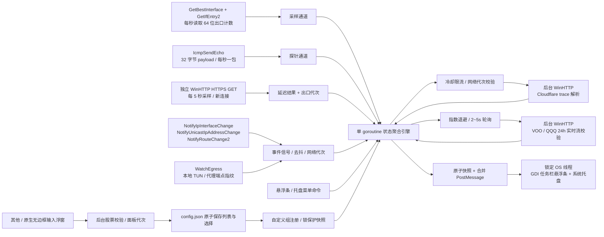

# 调度与架构设计

## 1. 核心职责分离

1. **单线程 Win32 UI 层 (`internal/ui`)**：
   - 锁定主 OS 线程，同时承载 **任务栏分层置顶悬浮条 (`WS_EX_LAYERED | WS_EX_TOOLWINDOW | WS_EX_TOPMOST | WS_EX_NOACTIVATE`)** 与 **系统托盘动态图标 (`Shell_NotifyIconW`)**。
   - 锁定时启用 `WS_EX_TRANSPARENT` 鼠标穿透；解锁时支持左键拖拽位置与 `tooltips_class32` 原生悬停提示。
   - 不在 UI 线程执行任何 ICMP、WinHTTP、注册表或磁盘写入。
2. **固定 1 秒网络心跳与网卡采样 (`internal/network` + `internal/monitor`)**：
   - `GetBestInterface` + `GetIfEntry2` 仅统计当前路由出口网卡的 64 位累计字节，避免物理网卡与 VPN 虚拟接口重复计数。
   - 每秒对 `1.1.1.1` / `8.8.8.8` 发起 ICMP 心跳；主目标失败时同周期复核备用目标，必要时通过 TCP 443 和最近 HTTPS 通信/流量作连通性旁证。
   - 已在线时单次失败保持绿色；连续 2～3 次失败进入 `Degraded`，连续 4 次失败进入 `Offline`，一次成功恢复 `Online`。旁证只参与连通判断，不生成或沿用延迟数值。
3. **独立 HTTPS 延迟 (`internal/network/latency_windows.go`)**：
   - 每 5 秒以新 WinHTTP 连接请求 `https://www.cloudflare.com/cdn-cgi/trace`，继承系统代理与 TLS 验证；计时从发送前到收到响应头，包含 DNS、建连和 TLS。
   - `Snapshot.Probe` 保存连通性证据；`Snapshot.Latency` 单独保存 HTTPS 耗时、目标、方法、采样时间和错误。UI 仅展示新鲜有效的 HTTPS 延迟。
   - 出口/路由变化或手动刷新时递增独立延迟代次，取消旧请求并立即重测；迟到的旧代次结果不允许覆盖新出口。失败或超过 15 秒未更新时显示 `--`。
4. **事件驱动公网 IP 与国家定位 (`internal/ipinfo` + `internal/network/egress_windows.go`)**：
   - 监听系统网卡、IP 地址、路由变更通知，750ms 事件去抖。
   - 每秒本地检测系统代理、TUN 网卡与常见代理内核（`mihomo`、`sing-box`、`xray`、`clash` 等）的远端连接指纹，连续稳定 2 秒后触发复核。
   - 使用 WinHTTP 请求 `https://www.cloudflare.com/cdn-cgi/trace`，自动继承系统代理与系统 TLS 根证书，禁用 Keep-Alive 确保探测新节点出口。
5. **全球多市场行情 (`internal/market`)**：
   - 支持 9 组标的。腾讯查询映射覆盖 A股、港股、日韩、欧洲、黄金/布油及 `159632` / `159655` 深交所场内 ETF；其他分组可回退到 Yahoo v7 / v8。这两只 ETF 仅使用腾讯场内数据，失败时返回错误，避免备用数据时效不明。
   - 美股扩展时段读取夜盘、盘前、盘后等对应价格与成交时间；独立解析标的并校验资产类型、币种、有限数值和涨跌幅一致性。
   - 行情采用独立轮询、失败退避、缓存与过期判断；行情请求耗时不会充当网络延迟。

6. **自定义股票对 (`internal/watchlist`, `config`, `market/custom*`, `ui/custom*`)**：
   - 六位数字保留前导零，标准化为沪/深/北交所内部代码；通过腾讯行情的代码与股票品类核实有效性，使用 Win32 解码中文名称。
   - 列表与当前组存于同一配置文件。只有磁盘保存成功后才替换注册表、菜单状态并通知聚合引擎刷新。
   - 校验任务携带面板代次；关闭/重开浮窗后，迟到结果不能保存到新面板。组切换通道保留最新选择，删除活动组时立即切回默认组。
