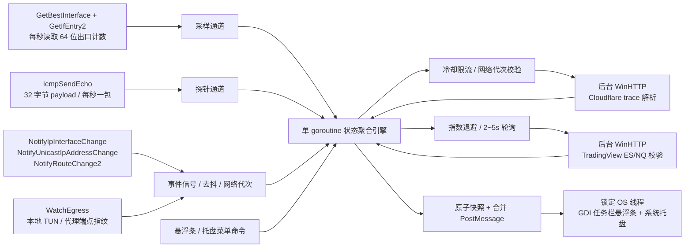

# 调度与架构设计

## 1. 核心职责分离

1. **单线程 Win32 UI 层 (`internal/ui`)**：
   - 锁定主 OS 线程，同时承载 **任务栏分层置顶悬浮条 (`WS_EX_LAYERED | WS_EX_TOOLWINDOW | WS_EX_TOPMOST | WS_EX_NOACTIVATE`)** 与 **系统托盘动态图标 (`Shell_NotifyIconW`)**。
   - 锁定时启用 `WS_EX_TRANSPARENT` 鼠标穿透；解锁时支持左键拖拽位置与 `tooltips_class32` 原生悬停提示。
   - 不在 UI 线程执行任何 ICMP、WinHTTP、注册表或磁盘写入。
2. **固定 1 秒网络心跳与网卡采样 (`internal/network` + `internal/monitor`)**：
   - `GetBestInterface` + `GetIfEntry2` 仅统计当前路由出口网卡的 64 位累计字节，避免物理网卡与 VPN 虚拟接口重复计数。
   - `IcmpSendEcho` 每秒发送单个 32 字节探测包（650ms 超时），失败下一秒切换 `1.1.1.1` / `8.8.8.8`，单次失败转黄色待确认（`Degraded`），连续两次失败转红色断网（`Offline`），一次成功即恢复绿色（`Online`）。
3. **事件驱动公网 IP 与国家定位 (`internal/ipinfo` + `internal/network/egress_windows.go`)**：
   - 监听系统网卡、IP 地址、路由变更通知，750ms 事件去抖。
   - 每秒本地检测系统代理、TUN 网卡与常见代理内核（`mihomo`、`sing-box`、`xray`、`clash` 等）的远端连接指纹，连续稳定 2 秒后触发复核。
   - 使用 WinHTTP 请求 `https://www.cloudflare.com/cdn-cgi/trace`，自动继承系统代理与系统 TLS 根证书，禁用 Keep-Alive 确保探测新节点出口。
4. **TradingView 期货主力行情监控 (`internal/market`)**：
   - 后台通过 WinHTTP POST `https://scanner.tradingview.com/futures/scan` 一次获取 `CME_MINI:ES1!` 与 `CME_MINI:NQ1!`。
   - 严格校验合约名称、类型（`futures`）、币种（`USD`）、有限数值、最新价与涨跌额/涨跌幅一致性（容差 `rel_tol=1e-6, abs_tol=0.02`），并限制响应正文上限 2047 字节。
   - `ES` 与 `NQ` 独立判定健康度，支持延时模式（如 `delayed_streaming_600`）提示，看门狗超时或请求失败立即亮红灯并按指数退避（HTTP 401/403/429 退避 60 秒）。
